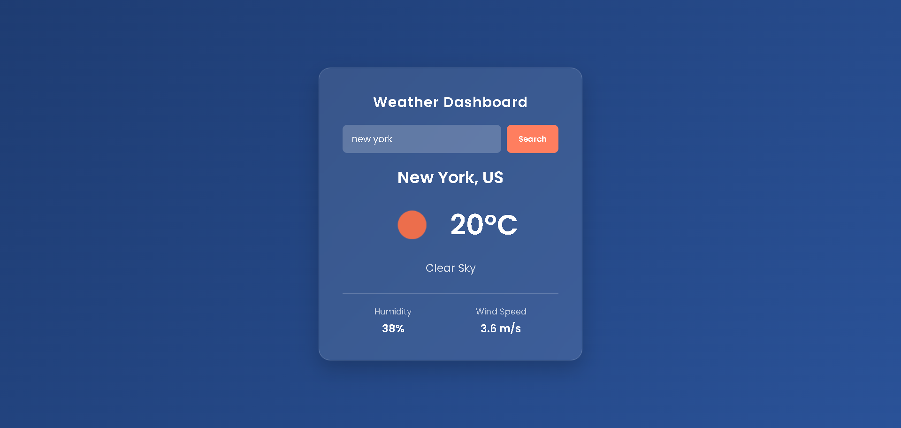

# Weather Dashboard


A modern, real-time weather application built with Vanilla JavaScript. This is Project 2 of my 10-project developer portfolio series.



## 🚀 Live Demo

**[View the Live Website Here](https://glowing-marshmallow-487dbf.netlify.app)**


## 📖 About The Project

The Weather Dashboard allows users to search for any city in the world and receive real-time weather data. 

The primary goal of this project was to demonstrate proficiency in **asynchronous JavaScript** and **API integration** without relying on any front-end frameworks. It showcases the ability to fetch data from a third-party server, handle loading states, manage errors gracefully, and dynamically update the DOM.

## ✨ Key Features

*   **Real-Time API Integration:** Fetches live weather data using the OpenWeatherMap API.
*   **Asynchronous JavaScript:** Utilizes `async/await` and the `Fetch API` to handle network requests.
*   **Robust Error Handling:** Gracefully handles invalid city names (404) and invalid API keys (401), displaying user-friendly error messages.
*   **Loading States:** Includes an animated spinner to indicate to the user that data is being fetched.
*   **Modern UI:** Features a responsive "Glassmorphism" design (transparent, blurred backgrounds) using pure CSS, complete with dynamic weather icons.
*   **Keyboard Support:** Users can trigger a search by pressing the "Enter" key, improving the user experience.

## 🛠️ Tech Stack

*   **HTML5:** Semantic structure.
*   **CSS3:** Custom properties (variables), Flexbox, animations (`@keyframes`), and Glassmorphism effects.
*   **Vanilla JavaScript (ES6+):** DOM manipulation, Event Listeners, `async/await`, Promises, and Error Handling.
*   **OpenWeatherMap API:** For fetching live weather data.

## ⚙️ How to Run Locally

Because this project uses a third-party API, you will need a free API key to run it.

1.  **Clone the repository:**
    ```bash
    git clone https://github.com/waseemqureshi2020/weather-dashboard.git